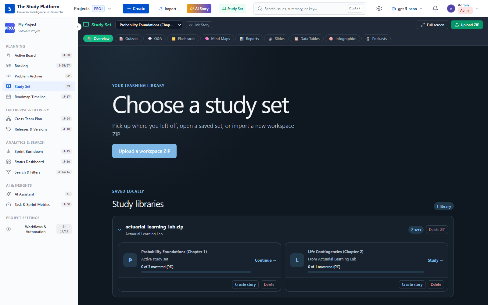
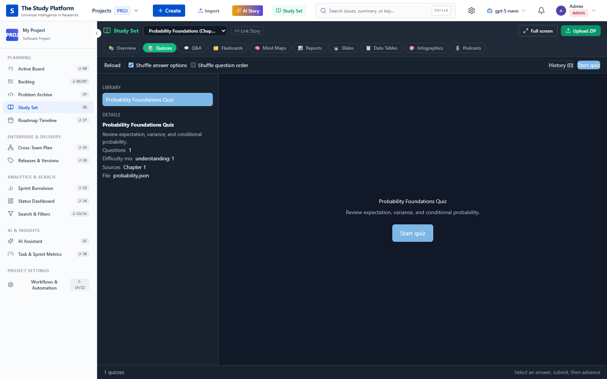
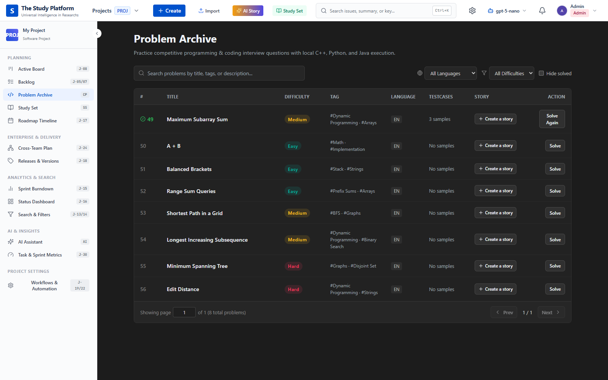
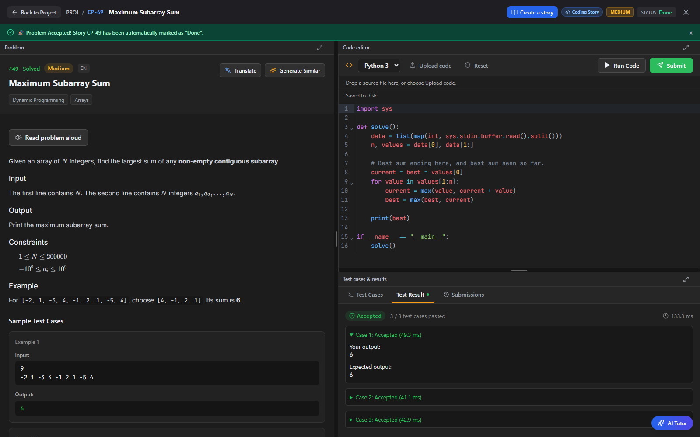
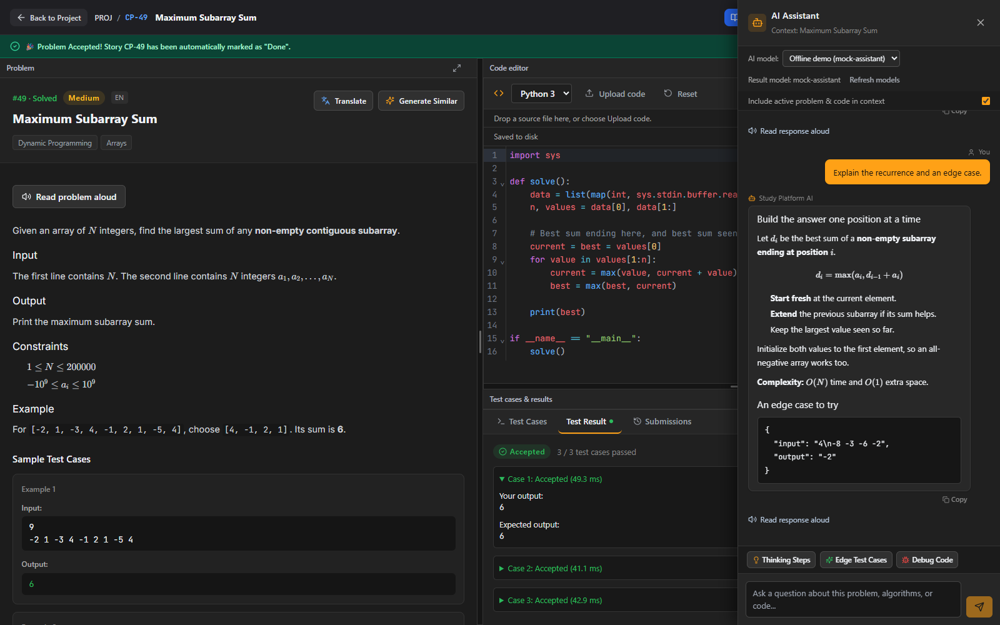
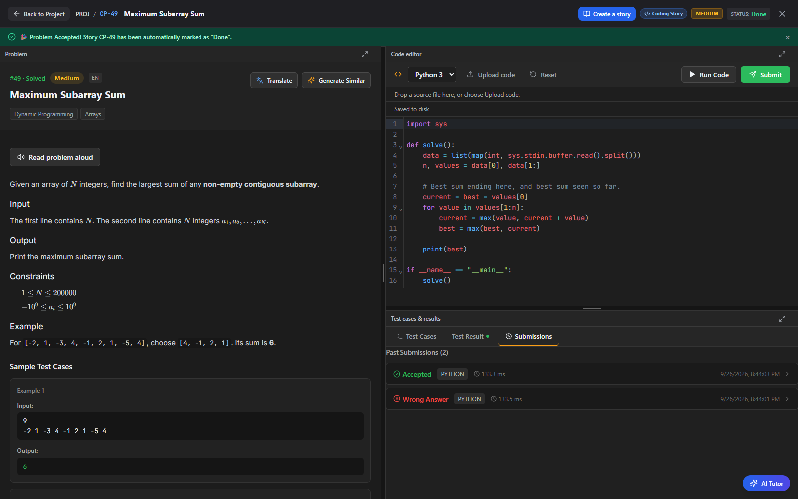

# The Study Platform - Universal Intelligence in Researchs

The Study Platform is a local research, learning, and competitive programming workspace built with React, Vite,
FastAPI, Flask, and SQLite. Browse problems, write or upload solutions, run test cases,
and track submissions. AI tools provide hints, explanations, and generated
problems, with Markdown and LaTeX rendering and saved speech narration through
The Connector.

Editor drafts save to disk, submission history can be exported as a ZIP, and
the workspace can be shared with devices on your LAN. See
[Models, submissions, and workspace features](docs/llm-and-submissions.md) for
the detailed configuration and API behavior.

## Screenshots

Screenshots use demonstration data.

To refresh these images from the application, run `npm run screenshots` in
`e2e/`. The capture uses an isolated demonstration database and local AI fixtures.

### Study-set library

Study libraries remain compact until expanded, then show chapter-level study
sets, Jira story actions, and persisted overall progress.



### Interactive study quiz

Each study set provides dedicated quiz, Q&A, flashcard, mind-map, report,
slide, data-table, infographic, and podcast views with LaTeX support.



### Problem archive

Search and filter the problem collection, with solved problems marked in green.



### Solving workspace

Read the statement beside the code editor and test console. Resize or expand
panels, upload source files, and save drafts automatically.



### AI assistant

Discuss the current problem with formatted explanations, mathematical formulas,
and code examples. Read-aloud controls generate saved Connector-backed audio.



### Submission history

Review verdicts, submitted code, and test results, or export all submissions.



## Quick start

Windows:

```powershell
.\setup.bat
.\run.bat
```

Linux/macOS:

```bash
./setup.sh
./run.sh
```

If a Python virtual environment or Conda environment is already active, setup
installs into that environment and run uses the same interpreter. Otherwise,
the scripts create and reuse `.venv` in this project.

Start The Connector before The Study Platform. The Study Platform uses its configured
`CONNECTOR_BASE_URL` for both LLM requests and speech. The Connector owns the
Kokoro runtime, voice, language, speed, and device configuration; this project
does not install or launch a separate speech service.

Podcast rendering sends each speaker's voice ID as the Connector's `actor`
setting. The default pair is `af_heart` and `am_adam`; podcast cast entries can
override these with `actor` (or the legacy `voice` field). Both speakers must
have spoken dialogue and use distinct actors. A monologue or failed speech
request produces a clear error instead of a completed silent podcast.

To open The Study Platform from another device on the same LAN, run:

```powershell
.\run_lan.bat
```

Open the printed `LAN: http://<computer-IP>:<port>` address on that device.
The wrapper forwards options, for example `run_lan.bat --frontend-port 5190`.
Its equivalent command is `python run.py serve --lan`, or
`./run.sh serve --lan` on Linux/macOS. The frontend handles API and narration
requests through its local backend proxy. Devices share the same stored data.

Choose the frontend and backend ports independently:

```powershell
# Local access
.\run.bat --host 127.0.0.1 --frontend-port 8080 --backend-port 8000

# LAN access
.\run_lan.bat --frontend-port 8080 --backend-port 8000
```

The same flags work with `python run.py` and `./run.sh`. Open the printed
frontend address; the API proxy automatically uses the chosen backend port.
Command-line ports override the saved `frontend_port` and `backend_port` in
`%APPDATA%/the_study_platform/settings.json`. Edit those JSON fields to remember
your choices. Port values in `.env` or terminal environment variables do not
override this settings file.

The project `port_mapping.json` defines the default backend and frontend ports,
currently `8011` and `5100`. The runner checks
both ports before launch and advances to the next available port when needed.
It prints the actual URLs selected for the session. Valid ports are 1–65535;
frontend and backend always receive separate ports. Use `.\run.bat --help`
to list all launcher options.

As in the sample project, new development configurations bind both services to
`0.0.0.0` for LAN access. Existing `.env` host values are preserved. `--lan`
overrides an existing loopback default; an explicit `--host` takes precedence
and applies to both services. Startup prints frontend and API URLs for detected
network adapters. The shorter sample flags `--frontend` and `--backend` also work.

## Configuration

Copy `.env.example` to `.env` to customize the bind address,
or database path. Environment variables already defined in the terminal take
precedence over values in `.env`.

| Variable | Default | Purpose |
| --- | --- | --- |
| `BACKEND_HOST` | `0.0.0.0` | Bind address for both services; use `127.0.0.1` for local access |
| `DATABASE_PATH` | `<data_dir>/jira.db` | Optional override for the shared SQLite database |
| `WORKSPACE_STORAGE_DIR` | `<data_dir>/workspace/<database-id>` | Optional override for saved drafts and narration files |
| `CONNECTOR_BASE_URL` | `http://127.0.0.1:8301/v1` | The Connector API for AI and speech requests |
| `CONNECTOR_SPEECH_TIMEOUT_SECONDS` | `180` | Timeout for Connector speech generation |
| `LLM_MODEL` | First discovered model | Active Connector configuration ID |
| `AUTO_SEED` | `0` | Set to `1` to import sample problems into a new, empty database |
| `MIGRATE_LEGACY_DATABASES` | `0` | Set to `1` to import data from legacy database locations |

The application uses one physical SQLite file for both project/story data and
competitive-programming data. When `MIGRATE_LEGACY_DATABASES=1`, an existing
legacy problem archive is imported if the unified problem tables are empty. Its
database file is retained as a backup, and missing draft/audio workspace files
are copied without overwriting newer files.

The application name used for on-disk paths is `the_study_platform`. On first
production startup, settings are created at
`%APPDATA%/the_study_platform/settings.json`:

```json
{
  "schema_version": 1,
  "data_dir": "",
  "frontend_port": 5100,
  "backend_port": 8011
}
```

The default data folder is `%TEMP%/the_study_platform`. Open **Settings → Storage →
Data storage** on the host to enter an absolute folder, save it, or reset the default.
An empty `data_dir` selects the default. The settings JSON may also be edited
while the application is stopped, using an absolute folder path. The shared
database, workspace files, study voices, and attachments follow this folder.
Explicit database, workspace, and upload environment overrides retain precedence
and are displayed in Settings.

Both generated `run.bat` files check for the settings file and create `{}` if
it is absent. They then add any missing `frontend_port` / `backend_port` fields
from the `port_mapping.json` beside `server.exe`,
reread the saved values, and pass the ports to `server.exe`. Existing folder
settings, custom ports, and other fields are preserved. Ports must be JSON
integers from 1 to 65535. Invalid JSON or invalid ports stop startup with an error.
The mapping must exist and contain both valid port fields, even when saved ports
already exist. Changing the mapping affects only missing settings fields.

A changed folder applies after restarting. Existing files are not moved: stop
the app and copy the old data folder to the selected destination before starting
again if you want to retain its contents. LAN clients use the host's storage and
can view its location; storage settings can only be saved from the host's local
browser. Source, Debug, and Release installations share the same user settings.
Choose a durable folder for long-term data because the operating system can
clean `%TEMP%`. On Linux/macOS, settings use `$XDG_CONFIG_HOME/the_study_platform`
or `~/.config/the_study_platform`, with the system temp folder as the data default.

New databases start with no problems or stories. The required local admin and
default project are still created. Sample problems (and their linked coding
stories) are added only when `AUTO_SEED=1` is explicitly configured; legacy
problems and stories are imported only when `MIGRATE_LEGACY_DATABASES=1`.

## API

| Method | Path | Behavior |
| --- | --- | --- |
| `GET` | `/api/health` | Backend health check |
| `GET` | `/api/settings` | View configured and active data folders and overrides |
| `PUT` | `/api/settings` | Save the host's data folder for the next startup |
| `GET` | `/api/problems` | Browse and search saved problems |
| `POST` | `/api/llm/generate-tags` | Generate and persist tags for up to six untagged problems |
| `POST` | `/api/problems/upload` | Import a problem collection |
| `GET` | `/api/llm/models` | Discover available AI models |
| `POST` | `/api/run` | Execute code with custom input |
| `POST` | `/api/submit` | Judge and save a solution; supports asynchronous jobs |
| `GET` | `/api/submission-jobs/<job-id>` | Poll submission progress and results |
| `GET` | `/api/submissions` | Browse submission history |
| `GET` | `/api/submissions/export.zip` | Download all submissions |
| `POST` | `/api/chat` | Ask the AI assistant |
| `DELETE` | `/api/audio/cache` | Clear saved narration files |

See [Models and submission status](docs/llm-and-submissions.md) for request
formats, draft persistence, and audio endpoints.

## Tests and build

Build portable Windows distributions with Python and Node.js/npm installed on
the build machine:

```powershell
.\build.bat
# Equivalent: python build.py
# Reuse dependencies: .\build.bat --skip-install
```

The script uses the active Python/Conda environment or the project `.venv`,
builds React, and packages the backend with PyInstaller. It generates
`dist/Debug` (local, `127.0.0.1`) and `dist/Release` (LAN, `0.0.0.0`). Each folder
contains `server.exe`, `public/`, `runtime.json`, `run.bat`, and `port_mapping.json`. Copy the entire
chosen folder to another Windows computer; Python and Node.js are not needed to
start the app. Build artifacts never include your source `.env` or runtime data.

```powershell
.\dist\Debug\run.bat
.\dist\Release\run.bat --frontend 4000 --backend 9000
```

Verify both generated profiles with isolated settings and data:

```powershell
python tests/smoke_portable.py
python tests/smoke_portable.py --with-toolchains
```

Before building, edit the project-root `port_mapping.json` to choose defaults:

```json
{
  "frontend_port": 5100,
  "backend_port": 8011
}
```

The build validates this file before installing dependencies or compiling and
copies it unchanged into both profiles. Rebuilding replaces the artifact copy;
it preserves per-user settings. You can also edit a portable folder's mapping
to set defaults for users who do not yet have saved ports.

Both builds read ports from the shared per-user settings JSON, filling missing
fields from their included mapping, with busy-port fallback. Port precedence is
command-line flags, saved JSON values, then `port_mapping.json`. Source launches
use the project-root mapping. Bind-address
precedence remains command-line options, terminal environment, the
distribution's optional `.env`, then `runtime.json`.
The Connector remains a separate service for AI and speech. Running submitted
Python, C++, or Java programs requires the corresponding interpreter/compiler
on the host; the packaged web server itself does not need them.

See [Comparison with the sample project](docs/sample-project-comparison.md) for
implementation differences and remaining gaps.

Run the existing checks with:

```powershell
python -m unittest discover -s backend\tests -v
python -m unittest discover -s tests -v
cd frontend
npm test
npm run build
cd ..\e2e
npm run typecheck
npm test
```

The Playwright suite starts the unified backend and Vite automatically, then exercises
the live API through the frontend proxy using an isolated test database. It
uses Microsoft Edge by default. On macOS it uses Playwright's WebKit-based
Desktop Safari profile, which is the supported automation equivalent for
Safari rendering.

On a fresh macOS checkout, install the WebKit browser once before running the
tests:

```bash
cd e2e
npm run install:webkit
```

## Project layout

```text
backend/                  Unified FastAPI/Flask application, SQLite store, and tests
frontend/                 React/Vite application and frontend unit tests
e2e/                      Standalone TypeScript Playwright end-to-end tests
docs/                     Feature documentation and application screenshots
tests/                    Root setup and launcher tests
setup.py / setup.*        Cross-platform dependency setup
run.py / run.*            Combined backend/frontend runner
run_lan.bat               Windows launcher for LAN access
build.py / build.bat      Portable Windows Debug/Release packaging
dist/Debug, dist/Release  Generated portable distributions (ignored)
```
